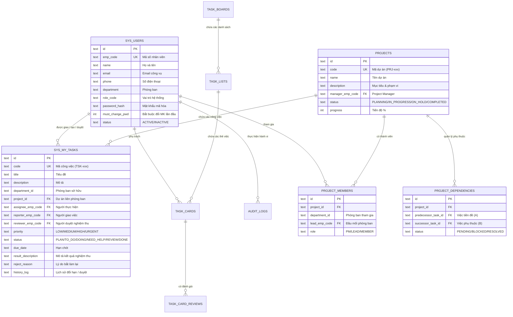

# BÁO CÁO AUDIT HIỆN TRẠNG HỆ THỐNG TBS (GIAI ĐOẠN 1)
**Phục vụ chuẩn bị Pilot 100 người dùng trong 1 tháng (3 Chức năng)**
*Thời gian thực hiện: Tháng 10/2026*

---

## 1. Kết quả quét các thành phần cốt lõi

### 1.1 Danh sách nhân sự bị cố định (`STAFF_MEMBERS`, `SYSTEM_USERS`, `WORKER_SYSTEM_USER_MAP`)
- **`web/src/modules/tasks/TaskBoardView.tsx` (Dòng 42-48):**
  - Mảng `STAFF_MEMBERS` chứa 5 nhân sự mẫu hardcoded (Phạm Nguyễn Anh Huy, Nguyễn Văn Hùng, Trần Thị Mai, Lê Hoàng Nam, Đặng Thu Thảo). Dùng để render tab tải công việc nhân viên (Workload view).
- **`web/src/modules/tasks/MyTasksKanbanView.tsx` (Dòng 56-69):**
  - Mảng `STAFF_MEMBERS` chứa 12 nhân sự hardcoded (hầu hết thuộc IT và Nhân sự).
  - Dòng 949, 1213, 1239, 1904: Dùng trực tiếp trong modal tạo task mới, lọc người thực hiện, gán checklist. Khi 100 user từ 7 phòng ban vào dùng, Trưởng phòng Kế toán, QC, May, Kho vận... **không thể tìm thấy nhân viên của mình để giao việc**.
- **`web/public/_worker.js` (Dòng 121-135):**
  - `WORKER_SYSTEM_USER_MAP`: Chứa ~13 nhân sự hardcoded. Nếu mã NV ngoài danh sách này gửi request không kèm đầy đủ claim, Worker tự gán về fallback hoặc `roleLevel: 4, departmentCode: 'TBS'`.
- **`web/src/lib/userProfiles.ts` (Dòng 23-450):**
  - `SYSTEM_USERS`: Chứa ~20 nhân sự định nghĩa sẵn trong code.

### 1.2 Dữ liệu bộ nhớ tạm & Fallback (`inMemoryTasks`, `DEFAULT_KANBAN_TASKS`)
- **`web/src/app/api/tasks/route.ts` (Dòng 10-176, 310, 357, 448, 613, 691):**
  - `const DEFAULT_TASKS = [...]` gồm 7 task mẫu.
  - `let inMemoryTasks = [...DEFAULT_TASKS];`
  - Nếu `getDbBinding()` là null hoặc database trả về rỗng/lỗi, API âm thầm chuyển sang đọc và ghi trên `inMemoryTasks`. Dữ liệu sẽ mất sạch khi Next.js reload/restart.
- **`web/public/_worker.js` (Dòng 4492-4603, 4666, 4710, 4712):**
  - `const DEFAULT_KANBAN_TASKS = [...]` gồm 5 task mẫu.
  - Nếu Cloudflare D1 query rỗng hoặc lỗi, API trả về `filteredFallback` (từ `DEFAULT_KANBAN_TASKS`) với status 200, che giấu lỗi kết nối D1.

### 1.3 Dữ liệu mẫu Dự án (`PROJ-DIGITAL-2026`)
- **`web/src/modules/projects/ProjectWorkspaceView.tsx` (Dòng 32-45, 54):**
  - Khai báo hằng số `DEFAULT_PROJECT` mang mã `PROJ-DIGITAL-2026` ("Chuyển Đổi Số SKECHERS 2026"). Gọi `fetch('/api/projects?id=PROJ-01')`. Giao diện không có nút tạo dự án mới, không có quản lý task dự án chéo, không có thiết lập phụ thuộc.
- **`web/src/app/api/projects/route.ts` (Dòng 3-20, 28):**
  - Chỉ có phương thức `GET` trả về `MOCK_PROJECTS` (chứa duy nhất `PROJ-01: PROJ-DIGITAL-2026`). Không có `POST`, `PUT`, `DELETE`.
- **`web/public/_worker.js` (Dòng 5103-5118):**
  - Route `/api/projects` trả về trực tiếp JSON tĩnh của `PROJ-DIGITAL-2026`.

### 1.4 Component Kanban kéo-thả
- **`web/src/modules/tasks/MyTasksKanbanView.tsx`:**
  - Triển khai HTML5 Drag and Drop (`onDragStart`, `onDragOver`, `onDrop`).
  - Gồm 6 cột: `BACKLOG`, `TO_DO`, `DOING`, `REVIEW`, `DONE`, `NEED_HELP`.
  - Trên màn hình di động (màn hình dọc < 768px), các cột bị ép ngang, việc kéo thả bằng ngón tay rất dễ bị vuốt trượt màn hình hoặc thả nhầm cột.
- **`web/src/modules/tasks/TaskBoardView.tsx`:**
  - Quản lý task phòng ban theo mô hình Trello: Board -> Lists -> Cards.
  - Hỗ trợ kéo thả card giữa các list.

### 1.5 Logic đổi trạng thái thẻ
- **`web/src/modules/tasks/MyTasksKanbanView.tsx` (Dòng 525-570):**
  - Hàm `handleConfirmSubmitDone`: Bất kỳ ai nhập mô tả kết quả >= 5 ký tự đều có thể kéo/chuyển task sang `DONE`. Không kiểm tra quyền hạn (Role / Permission).
- **`web/src/app/api/tasks/route.ts` (Dòng 497-508):**
  - Phương thức `PATCH` chỉ kiểm tra độ dài `resultDescription` (>= 10 ký tự) khi chuyển sang `DONE`. **Hoàn toàn không chặn nhân viên tự nghiệm thu công việc của chính mình**.
  - Thiếu nút/trạng thái "Yêu cầu làm lại" (Reject) từ Trưởng phòng.

### 1.6 Cơ chế Session / Đăng nhập
- **Token Format:** Sử dụng token dạng `tbs_token_{empCode}_{timestamp}` hoặc JWT (ký HMAC với `JWT_SECRET`).
- **Lưu trữ:** Lưu đồng thời trong `document.cookie` (`tbs_token`, `Max-Age=31536000`), `localStorage`, `sessionStorage`.
- **Vấn đề phiên:**
  - Nếu token hết hạn hoặc format lệch giữa cookie và localStorage, client gọi `logoutUserProfile()` và xóa toàn bộ storage, gây hiện tượng "văng đăng nhập đột ngột" khi người dùng chuyển đổi mạng hoặc mở nhiều tab.
  - Route `/api/auth/login` trong `web/public/_worker.js` có 2 block xử lý trùng lặp (dòng 2768 và dòng 8304).

### 1.7 Cơ chế cập nhật dữ liệu hiện có
- Cả `MyTasksKanbanView.tsx` và `TaskBoardView.tsx` **hoàn toàn không có cơ chế polling (`setInterval`) hay WebSocket/SSE**.
- Người dùng A cập nhật xong, người dùng B ở máy khác bắt buộc phải ấn **F5** (tải lại trang) mới nhìn thấy trạng thái mới.

---

## 2. Sơ đồ quan hệ thực thể D1 Database (ERD)

---

## 3. Bảng tổng hợp Báo cáo Kiểm tra Hiện trạng

| STT | Hạng mục | File liên quan | Hiện trạng | Việc cần làm | Rủi ro nếu không sửa |
| :---: | :--- | :--- | :--- | :--- | :--- |
| **1** | **Nhân sự hardcode** | `MyTasksKanbanView.tsx` `TaskBoardView.tsx` `_worker.js` `userProfiles.ts` | Dùng mảng 5-12 người tĩnh, thiếu nhân sự 7 phòng ban | Đọc 100% nhân sự từ bảng `sys_users` trong D1. Bổ sung autocomplete & filter theo phòng | 100 user không tìm thấy tên mình để nhận việc, Trưởng phòng không giao việc được |
| **2** | **Bộ nhớ tạm (Fallback)** | `api/tasks/route.ts` `_worker.js` | Dùng `inMemoryTasks` & `DEFAULT_KANBAN_TASKS` khi D1 rỗng/lỗi | Xóa triệt để fallback bộ nhớ. Trả lỗi HTTP 500/503 rõ ràng khi D1 không kết nối được | Mất sạch dữ liệu task nhập trong 1 tháng mỗi khi server restart |
| **3** | **Dự án liên phòng ban** | `ProjectWorkspaceView.tsx` `api/projects/route.ts` `_worker.js` | Dữ liệu tĩnh `PROJ-DIGITAL-2026`, không có nút tạo mới | Tạo bảng `projects`, `project_members`, `project_dependencies`. Thêm UI tạo dự án & phát hiện nút thắt cổ chai | Lãnh đạo phàn nàn chức năng chỉ là "bản vẽ demo", không chạy thật được |
| **4** | **Phân quyền nghiệm thu** | `MyTasksKanbanView.tsx` `api/tasks/route.ts` `_worker.js` | Nhân viên tự chuyển thẻ sang `DONE` không cần duyệt | Khóa cột `DONE` đối với nhân viên. Thêm nút "Duyệt đạt" / "Bắt làm lại kèm lý do" cho Sếp. Kiểm tra ở API | Số liệu tiến độ bị ảo, nhân viên tự ý chốt việc chưa xong |
| **5** | **Thao tác Mobile** | `MyTasksKanbanView.tsx` `ProjectsOverviewPage.tsx` | Kéo thả Kanban trên màn hình nhỏ bị tràn ngang, trượt lệch | Bổ sung chế độ xem danh sách tabbed theo cột + Bottom sheet đổi trạng thái cho Mobile | Nhân viên kỹ thuật/chuyền không dùng được trên điện thoại |
| **6** | **Thông báo & Đồng bộ** | `NotificationCenter.tsx` `_worker.js` `tasks/route.ts` | Không có thông báo đẩy (Push/Zalo/Telegram); phải bấm F5 | Tích hợp `NotificationService` (Web Push, Telegram, In-app) + Polling 5-10s có ETag | Trễ deadline do không biết việc mới, màn hình quản đốc không tự nhảy việc |
| **7** | **Báo cáo & Tải việc** | `TaskBoardView.tsx` `_worker.js` | Thiếu nút xuất Excel đa sheet, thiếu biểu đồ Workload | Thêm chức năng xuất Excel (xlsx) chuẩn VN, phân tích quá tải công việc nhân sự | Trưởng phòng không thể họp giao ban, BGĐ không có số liệu chỉ đạo |
| **8** | **Phiên làm việc (Session)** | `auth.ts` `userProfiles.ts` `_worker.js` | Token không gia hạn trượt, dễ bị logout đột ngột | Chuẩn hóa cơ chế gia hạn session trượt trong ca làm việc, cảnh báo trước khi hết hạn | Người dùng ức chế vì bị văng ra ngoài giữa chừng khi đang nhập báo cáo |
